# Лоция

Система мониторинга посторонних объектов в контролируемой зоне аэропорта. Проект объединяет детекцию, трекинг, синтетические данные, реконструкцию сцены и визуально-языковую модель.

## Демонстрации

| Сценарий | Видео |
|---|---|
| Ручной выбор объекта и операторный режим трекера | [Открыть MP4, 28 секунд](assets/presentation/operator-mode.mp4) |
| Детекция, трекинг и VLM-описания | [Открыть MP4, 5 секунд](assets/presentation/full-pipeline.mp4) |
| Облёт реконструированной 3D-сцены | [Открыть MP4, 5 секунд](assets/depth-pro/airport-model-orbit.mp4) |

## Задача

Зона стоянки воздушного судна относится к областям повышенного риска. На ней одновременно находятся самолёты, наземная техника и персонал. Системе необходимо находить потенциально посторонние объекты, сохранять их идентичность между кадрами и помогать оператору разбирать инциденты.

  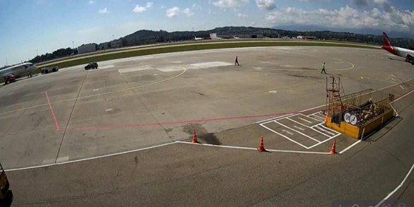

Основные ограничения проекта:

- мало реальных данных и размеченных примеров;
- фиксированный набор классов классического детектора не покрывает все возможные объекты;
- сцены содержат перекрытия, тени и сложные погодные условия;
- решение должно обрабатывать видеопоток с ограниченными вычислительными ресурсами;
- доступ к данным аэропортов ограничен требованиями безопасности.

## Архитектура

  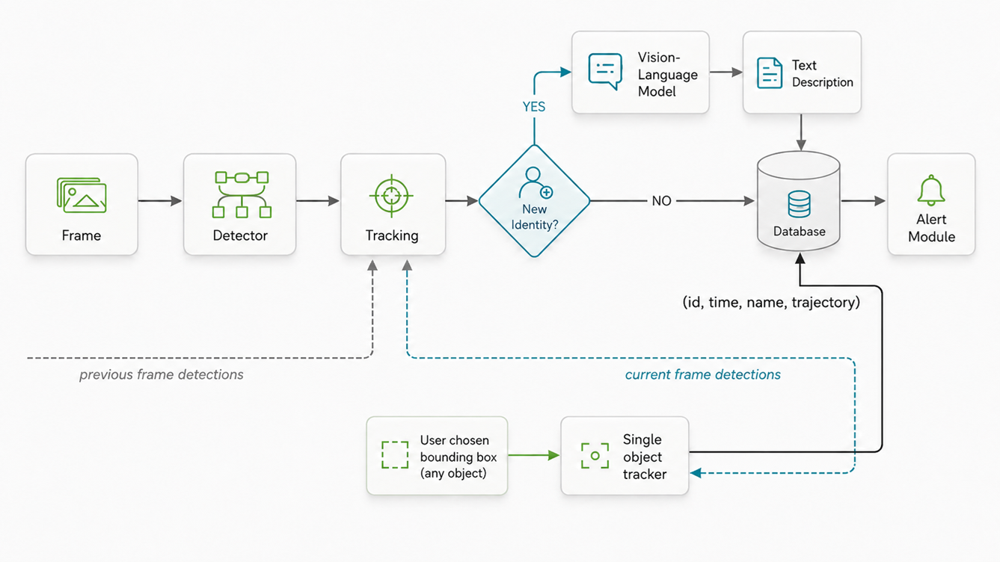

Пайплайн состоит из следующих частей:

1. **Детектор RT-DETRv2** находит объекты в кадре.
2. **Multi-object tracker** связывает детекции во времени.
3. **Single-object tracker** сопровождает объект, который оператор выделил вручную.
4. **VLM-модуль** формирует текстовый дескриптор нового объекта.
5. **Хранилище событий** связывает идентификатор, время, описание и траекторию.
6. **Alert-модуль** передаёт оператору информацию об обнаруженном объекте.

## Детектор

В проекте используется RT-DETRv2. Для обучения был собран semi-supervised pipeline. Итоговые значения получены на шестой итерации.

| Метрика | Значение |
|---|---:|
| Precision | **0.90** |
| Recall | **0.81** |
| mAP@50 | **0.71** |
| mAP@50:95 | **0.58** |

  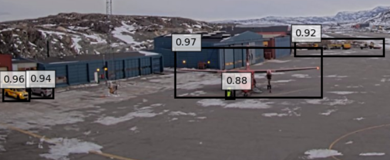

Детектор тестировался на сценах с воздушными судами, наземной техникой, персоналом и небольшими объектами на перроне.

  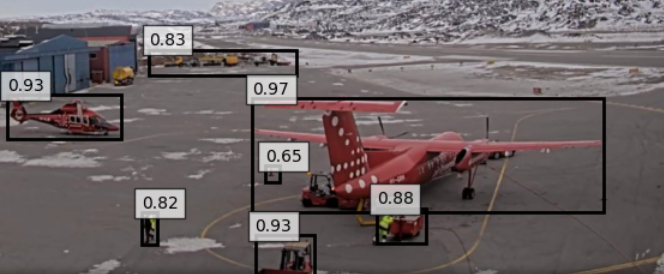
  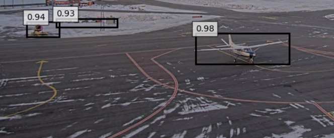

## Эксперимент с четвёртым каналом

Для ускорения адаптации к новой сцене к RGB-изображению добавлялся канал, описывающий изменения между референсным и текущим кадрами. Перед сравнением кадров применялся Canny-фильтр: он выделяет структурные изменения сцены устойчивее прямого вычитания изображений.

Простое попиксельное вычитание реагировало бы не только на новые объекты, но и на любые изменения внешнего вида фона: отражения в лужах, снег, мокрый асфальт, тени и перепады освещения. Сравнение контурных карт меньше зависит от локальной яркости и однородных изменений поверхности, поэтому лучше сохраняет активации на структурно новых объектах. Метод не устраняет влияние погоды полностью, но делает дополнительный канал устойчивее к таким изменениям.

|  |  |  |
|---|---|---|
|  | 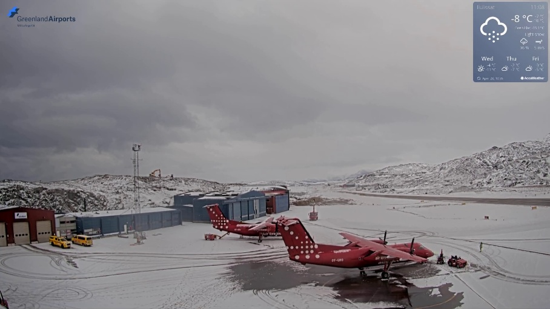 | 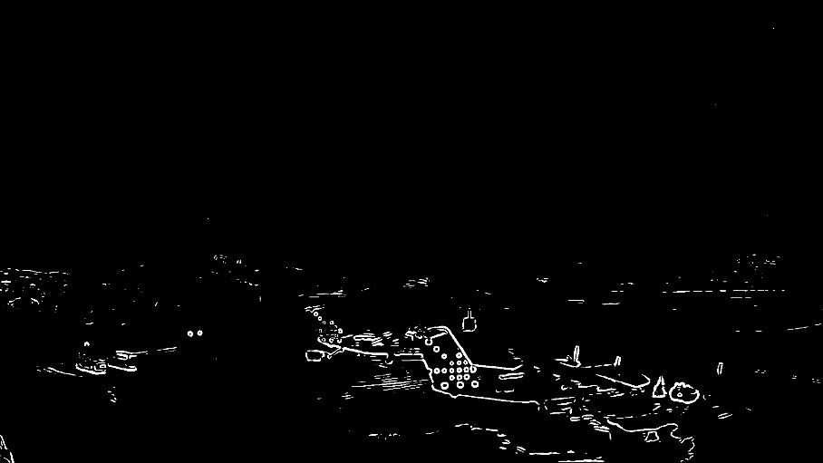 |
| **Референсный (пустой) кадр** | **Кадр инференса** | **Полученная активация** |

Дополнительная карта служит пространственным априорным сигналом: она заранее указывает модели области, в которых текущий кадр отличается от фонового состояния сцены. Детектор при этом по-прежнему извлекает семантические признаки из RGB, а карта активации направляет его внимание на потенциально новые объекты. Это особенно полезно при адаптации к стационарной камере, когда размеченных примеров мало, а фон в основном неизменен.

На первой половине эпохи экспериментальная модель получила:

| Вариант | Этап обучения | Precision | Recall |
|---|---|---:|---:|
| RGB + Canny-канал | 0.5 эпохи | **0.80** | **0.70** |

Модель быстро достигла рабочего baseline, но начала принимать тени за объекты. Поэтому четвёртый канал рассматривается как способ быстрой инициализации модели на новой сцене, а не как безусловная замена RGB-входа.

> Эти значения нельзя напрямую сравнивать с итоговыми метриками детектора: модели оценивались на разных стадиях обучения.

## Реконструкция сцены аэропорта с ML Depth Pro

Для генерации синтетических данных подготовлен отдельный пайплайн реконструкции сцены по одному кадру стационарной камеры. [ML Depth Pro](https://github.com/apple-aiml-research/ml-depth-pro) оценивает карту глубины и фокусное расстояние, после чего изображение переводится в геометрию сцены.

### Этапы реконструкции

1. Depth Pro оценивает глубину каждого пикселя и фокусное расстояние камеры.
2. Пиксели переносятся в трёхмерное облако точек через обратную проекцию.
3. Маска выделяет поверхность перрона, на которой допустимо размещать синтетические объекты.
4. По точкам покрытия оценивается плоскость земли.
5. Сцена переводится в систему координат Z-up, а покрытие преобразуется в треугольный mesh.
6. Обратная проекция проверяет согласованность реконструкции с исходным кадром.

  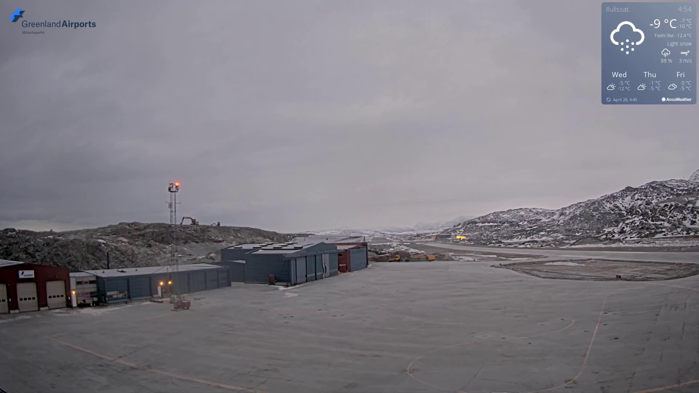
  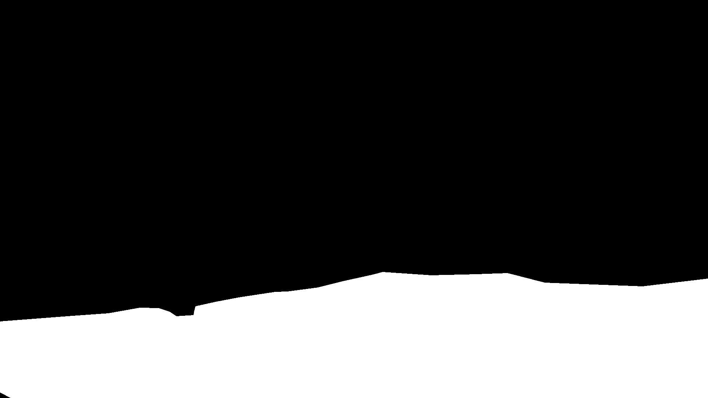

Такой подход позволяет быстро получить модель конкретной сцены в относительных, а не метрических координатах. Она сохраняет перспективу и взаимное расположение поверхностей, необходимые для согласованного размещения синтетических объектов, но не требует предварительной ручной калибровки камеры и точного восстановления физических размеров.

[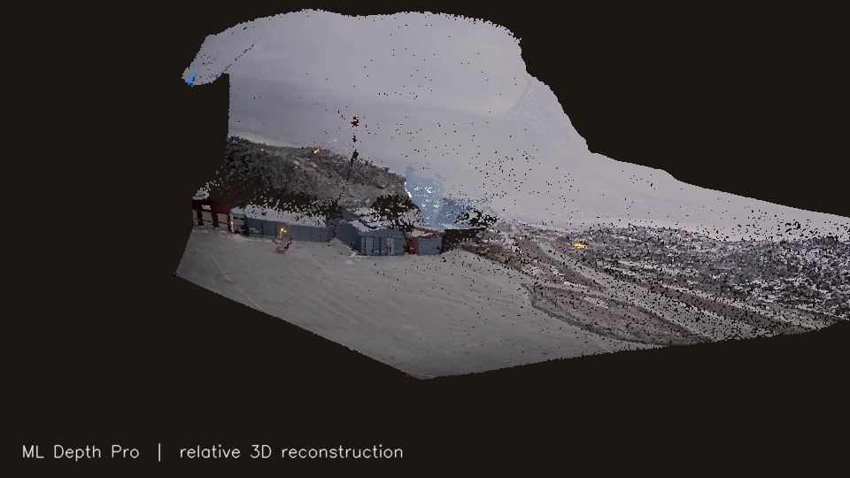](assets/depth-pro/airport-model-orbit.mp4)

Нажмите на изображение, чтобы открыть видео с визуализацией цветного облака точек.

## Синтетические данные

NVIDIA Isaac Sim используется для генерации специализированного датасета при дефиците реальных кадров. Сцена строится на основе восстановленного покрытия аэропорта, а параметры камеры приближаются к реальной системе наблюдения.

  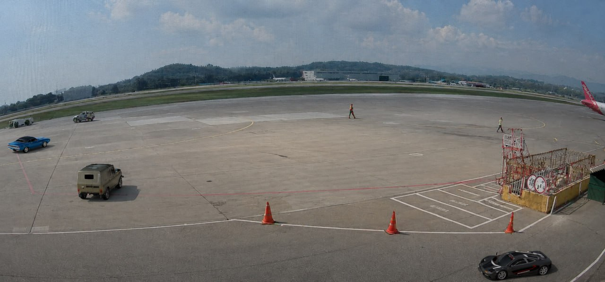

В генераторе можно изменять положение и параметры камеры, состав объектов, освещение, погодные условия и время суток. Симулятор создаёт точную разметку для каждого добавленного объекта.

  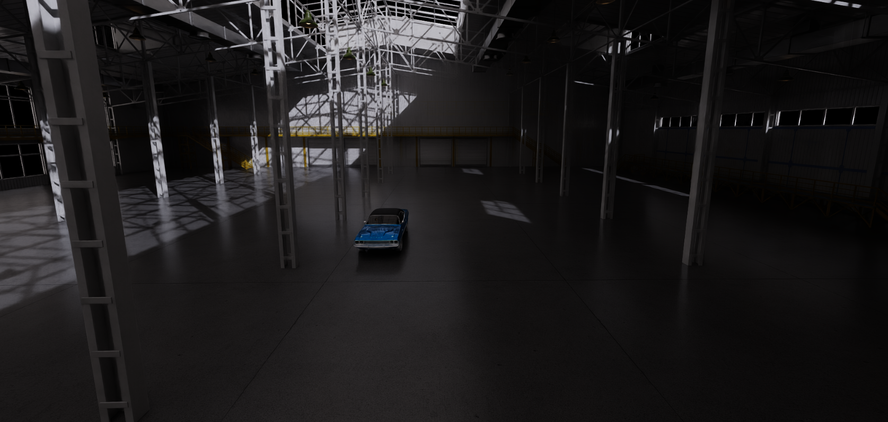
  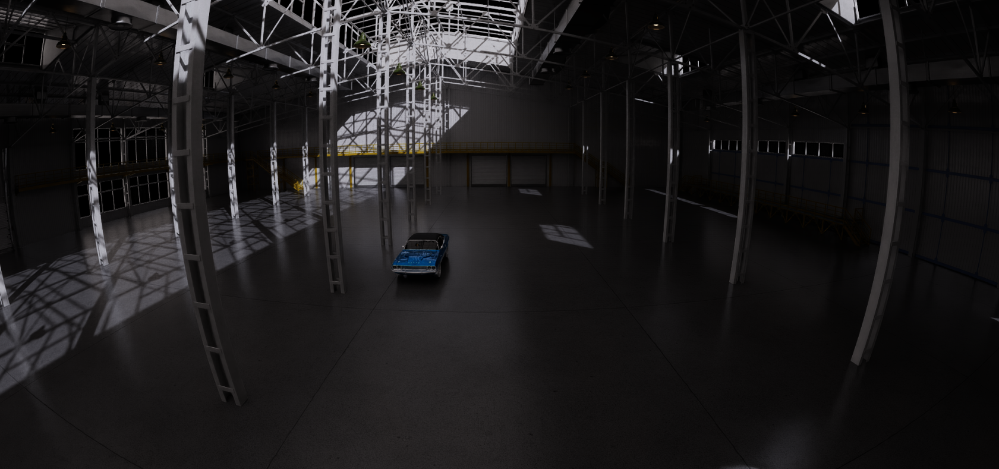

  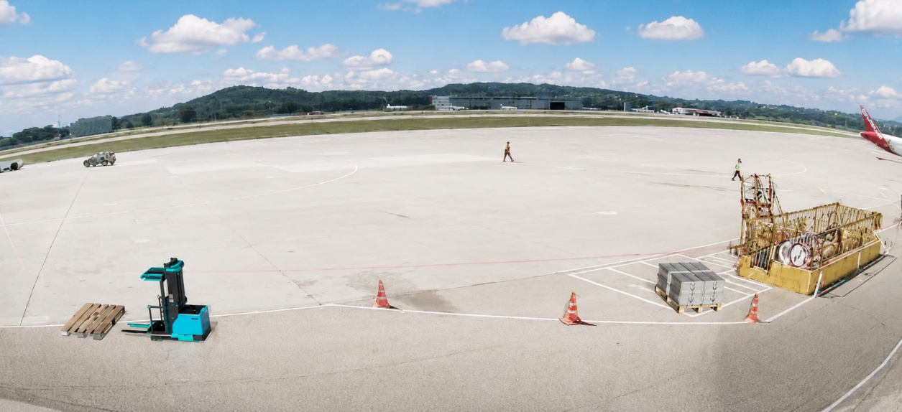
  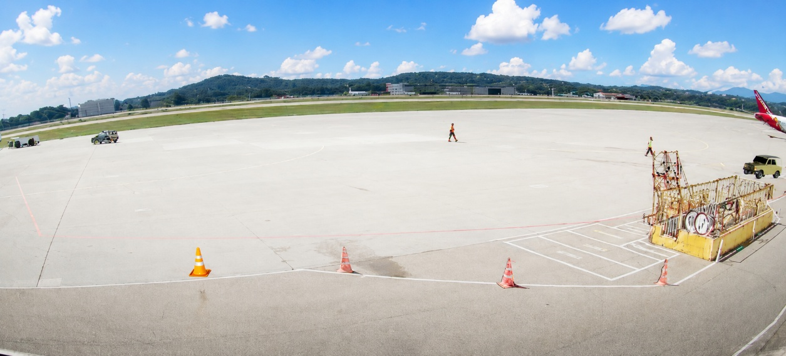

Следующий этап исследования — измерить вклад синтетических данных на фиксированном реальном тесте и оценить sim-to-real gap.

## Операторный режим трекера

Трекер поддерживает автоматическое сопровождение детекций и ручной выбор объекта оператором. Single-object tracker получает выбранный bounding box и продолжает сопровождение независимо от класса детектора.

Логика восстановления помогает сохранять исходную цель при временных перекрытиях. Frame Skip снижает частоту тяжёлых вычислений и позволяет настраивать компромисс между скоростью и качеством.

[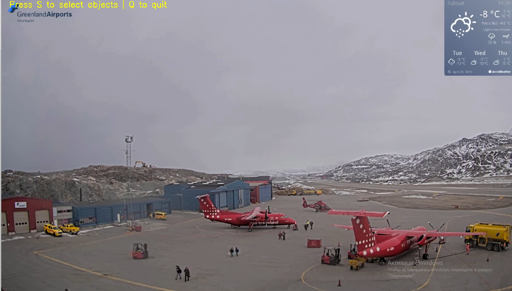](assets/presentation/operator-mode.mp4)

Нажмите на изображение, чтобы открыть видео.

## Текстовые описания объектов

VLM получает изображение объекта и формирует свободное текстовое описание его типа и визуальных признаков. Дескриптор связывается с идентификатором трека и может использоваться в уведомлениях или поиске по истории событий.

  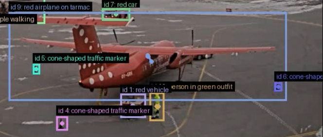

В отличие от детектора с ограниченным набором классов, VLM может описывать любые типы объектов, в том числе отсутствовавшие в обучающей выборке. Это особенно важно для безопасности: потенциально опасный или посторонний объект не должен оставаться без содержательного описания только потому, что его класс не был заранее предусмотрен при обучении.

## Визуализация полного решения

[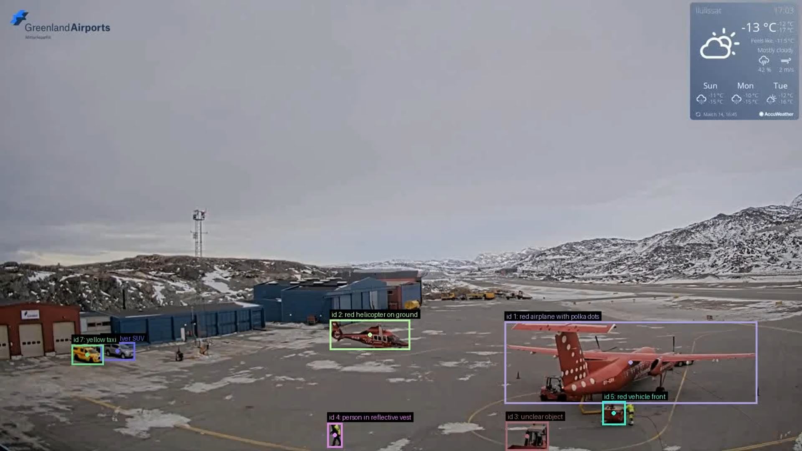](assets/presentation/full-pipeline.mp4)

Нажмите на изображение, чтобы открыть видео.

## Сводка экспериментов

| Компонент | Результат | Вывод |
|---|---|---|
| RT-DETRv2, шестая итерация | P = 0.90, R = 0.81, mAP@50 = 0.71 | Детектор формирует основу автоматического мониторинга |
| RGB + Canny-канал | P = 0.80, R = 0.70 после 0.5 эпохи | Быстрый baseline, но требуется защита от ложных срабатываний на тенях |
| Depth Pro + ground plane | Модель сцены в относительных координатах | Геометрия используется для согласованного размещения синтетических объектов |
| Synthetic data | Качественный прототип | Требуется количественная sim-to-real оценка |
| VLM-дескрипторы | Качественный прототип | Текстовые признаки дополняют фиксированный набор классов детектора |

## Оценка потенциального эффекта

На этапе бизнес-анализа команда оценила эффект четвёртого канала и синтетической генерации данных для условного аэропорта с 20 камерами.

| Показатель | Предварительная оценка |
|---|---:|
| Снижение необходимого объёма ручной разметки | 40–60% |
| Подготовка датасета | с 3 до 1–1.5 месяцев |
| Экономия на первичной разметке командой из пяти человек | 300–500 тыс. ₽ |
| Сбор и разметка реального датасета без синтетики | 1–2 млн ₽ |

Эти значения отражают проектные предположения, а не результаты production-внедрения. Для подтверждения необходим пилот на реальных камерах аэропорта.

## Ограничения

- Четвёртый канал чувствителен к теням и другим изменениям фона.
- Реконструкция Depth Pro работает в относительных координатах и не восстанавливает физический масштаб сцены.
- Для синтетических данных ещё не измерен разрыв между симуляцией и реальными камерами.
- Полный пайплайн ещё не прошёл проверку в инфраструктуре аэропорта.

## Материалы репозитория

- [демонстрация операторного режима](assets/presentation/operator-mode.mp4);
- [демонстрация полного пайплайна](assets/presentation/full-pipeline.mp4);
- изображения экспериментов и реконструкции в [assets/](assets/).

## Использованные технологии

- Python, PyTorch, OpenCV, Open3D
- RT-DETRv2
- ByteTrack
- OSTrack
- Apple ML Depth Pro
- NVIDIA Isaac Sim
- Vision-language models

## Благодарности

Проект выполнен при поддержке Фонда «Интеллект».

Проект использует идеи и открытые реализации [RT-DETR](https://github.com/lyuwenyu/RT-DETR), [ByteTrack](https://github.com/ifzhang/ByteTrack), [OSTrack](https://github.com/botaoye/OSTrack) и [ML Depth Pro](https://github.com/apple-aiml-research/ml-depth-pro).
